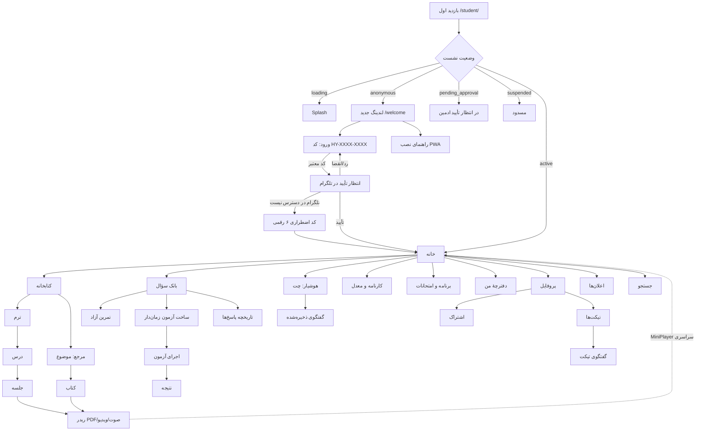
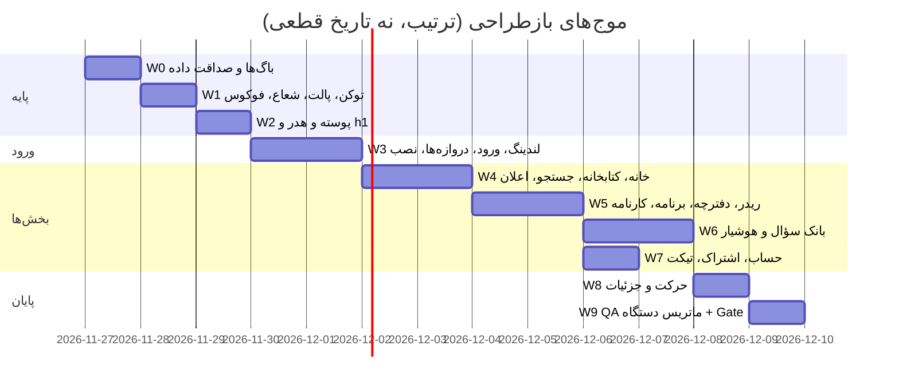

# پلن طراحی یکپارچهٔ وب‌اپ هامزیار (v3)

تاریخ: ۱۴۰۵/۰۹/۰۶ (2026-11-27)
دامنه: `apps/student` (مسیر `/student/`)، از ورود تا همهٔ بخش‌ها
مرجع قواعد: antislop v3.2.33 (هستهٔ `antislop.md` و مهارت‌های ui، human، layoutmobile، copywriting)
وضعیت: پیش‌نویس برای تأیید. هیچ کدی هنوز تغییر نکرده است.

---

## ۰. شواهد: چه چیزی دیده و اندازه‌گیری شد

| منبع | چه شد |
|---|---|
| مرورگر داخلی، حالت دمو | Home، Library، Exam، AI در 393×852 (iPhone 15)؛ Home و Exam در 820×1180 (iPad عمودی)؛ Home در 1280×720 |
| اندازه‌گیری خودکار در 360×800 (اندروید) | بدون overflow افقی در ۶ مسیر؛ ۷ کنترل زیر 40px در `/exam` و `/exam/setup` (چیپ‌های فیلتر)؛ **۰ عدد `h1` در همهٔ صفحه‌ها** |
| ممیزی کد ورود | `LoginScreen`، `GateScreens`، `InstallGuideScreen`، `auth.css`، `session.tsx`، `demo.ts` |
| در انتظار | ممیزی توکن‌ها و پوسته، ممیزی صفحه‌های داخلی (این بخش‌ها پس از رسیدن نتیجه کامل می‌شوند) |

محدودیت صادقانه: مرورگر داخلی Chromium است. اندازه‌ها شبیه‌سازی شده‌اند، نه Safari واقعی iOS. رفتار کیبورد iOS، `safe-area` واقعی و نوار آدرس جمع‌شونده فقط روی دستگاه واقعی قابل تأیید است. شبیه‌ساز iOS روی ویندوز در دسترس نیست.

---

## ۱. Design Read (جهت طراحی)

- محصول: دستیار مطالعهٔ پزشکی برای دانشجو، فارسی و RTL، بیشتر شب‌ها و روی گوشی.
- حس هدف: «میز مطالعهٔ مرتب یک دانشجوی پزشکی»؛ آرام، دقیق، خوانا. نه داشبورد نئونی.
- دیال‌ها: **ENERGY 2 / RHYTHM 2 / MOTION 2**
  - ENERGY 2: یک رنگ تأکید، بقیه خنثی.
  - RHYTHM 2: صفحه‌ها بر اساس محتوا فرق دارند، نه گرید کارت یکسان.
  - MOTION 2: حرکت فقط برای جهت‌یابی (ورود صفحه، باز شدن شیت، تأیید پاسخ)؛ هیچ حلقهٔ بی‌پایان.
- موتیف هویت: **خط پیشرفت با نشانگر نقطه** (یک hairline با یک نقطهٔ رنگی روی آن). همین یک الگو در ادامهٔ مطالعه، پیشرفت درس، آزمون، پخش صوت و تقویم تکرار می‌شود.
- تأکید واحد: آبی برند. رنگ نقش بخش‌ها فقط در کاشی آیکن، نه در حاشیه، دکمه یا پس‌زمینهٔ کارت.
- تم: تاریک پیش‌فرض می‌ماند (دلیل: مطالعهٔ شبانه، هویت فعلی مینی‌اپ)، روشن کامل و قابل انتخاب.

---

## ۲. ضعف اصلی (یک جمله)

**صفحه‌ها از یک خانوادهٔ کارت یکسان با رنگ‌های متفاوت ساخته شده‌اند و داده‌های خالی را به‌شکل «۰» نشان می‌دهند؛ نتیجه شبیه قالب داشبورد است، نه ابزار مطالعه.**

---

## ۳. نقشهٔ کامل مسیرها (درخت)



---

## ۴. درخت سیستم طراحی (هدف)

```text
tokens.css (تنها منبع)
├── primitive   رنگ خام، فاصله، شعاع، زمان
├── semantic    surface / text / border / status / accent
│   ├── accent: فقط brand (یک رنگ)
│   ├── status: success / warning / danger / info  ← دیگر از role-grades یا role-schedule قرض نمی‌گیرد
│   └── role-*: فقط tint آیکن بخش‌ها
├── component   btn / card / chip / input / sheet / tabbar / header
└── motion      enter / exit / press / sheet / reduced
components (یک پیاده‌سازی برای هر چیز)
├── DsButton      primary · secondary · ghost · danger    (ارتفاع 48 / 40)
├── DsCard        flat · raised · interactive              (یک شعاع: 14)
├── DsChip        فیلتر و انتخاب                           (حداقل 40، هدف لمسی 44 با padding)
├── DsListRow     ردیف لیست با chevron منطقی RTL
├── DsProgress    موتیف خط+نقطه                            (یک جزء برای همهٔ پیشرفت‌ها)
├── DsEmpty       حالت خالی با یک اقدام واقعی
├── DsSkeleton    هم‌شکل محتوای واقعی
├── DsError       پیام + «تلاش دوباره»
└── PageHeader    h1 واحد + زیرعنوان + اقدام اختیاری
shell
├── < 768      تب‌بار پایین ۵ آیتم + هدر ساده
├── 768–1023   ریل با برچسب کوتاه زیر آیکن + محتوا تا 720px یا دو ستون
└── ≥ 1024     سایدبار کامل + هدر + محتوا تا 1280px
```

قاعدهٔ شعاع (R-11): کنترل 10، کارت 14، شیت و مودال 20، قرص فقط برای چیپ و بج. بقیه حذف.
قاعدهٔ سایه (R-12): سطح پایه بدون سایه با hairline؛ فقط شیت، منو و MiniPlayer سایه دارند.
قاعدهٔ پالت (R-29): خنثی + آبی برند + سه رنگ وضعیت. بنفش دکمهٔ آزمون، زرد دکمهٔ تقویم و حاشیه‌های رنگی کارت‌ها حذف می‌شوند.

---

## ۵. یافته‌ها به تفکیک صفحه

اولویت: P0 خراب یا گمراه‌کننده، P1 ناهماهنگی جدی، P2 جزئیات حرفه‌ای.

### ورود و دروازه‌ها
| # | یافته | اولویت | قاعده |
|---|---|---|---|
| E1 | لندینگ وجود ندارد؛ کاربر ناشناس مستقیم فرم کد می‌بیند و نمی‌فهمد کد از کجا می‌آید | P0 | C-3 |
| E2 | لینک «خانه» به `/` ریشهٔ دامنه می‌رود و از اپ خارج می‌شود (`LoginScreen.tsx:183`، `GateScreens.tsx:35`) | P0 | R-24 |
| E3 | کد اضطراری ارقام فارسی را حذف می‌کند (`LoginScreen.tsx:299`) | P0 | R-03 |
| E4 | Splash بدون مهلت؛ درخواست گیرکرده یعنی چرخش بی‌پایان (`session.tsx:34`) | P0 | R-27 |
| E5 | polling تأیید بعد از انقضا هم ادامه دارد؛ اقدام «کد تازه» نیست (`LoginScreen.tsx:91-122`) | P1 | R-26 |
| E6 | «بررسی دوباره» در صفحهٔ انتظار هیچ بازخوردی ندارد (`GateScreens.tsx:85`) | P1 | R-27 |
| E7 | ادعای «معمولاً چند ساعت» و «سبک و سریع» بدون منبع | P1 | R-36 |
| E8 | راهنمای نصب iPad دکمهٔ Share را «پایین» می‌گوید؛ در iPad بالاست | P1 | R-38 |
| E9 | هفت شعاع مختلف در یک کارت ورود؛ سه سبک focus متفاوت | P1 | R-11 / R-32 |
| E10 | چشمک تم: تم «سیستم» اول تاریک رنگ می‌شود (`index.html:21`) | P2 | R-34 |
| E11 | هدر برند در ۵ جا کپی شده | P2 | C-1 |
| E12 | در iPad و دسکتاپ کارت 500px وسط صفحهٔ خالی | P2 | R-03 |

### پوسته (همهٔ صفحه‌ها)
| # | یافته | اولویت |
|---|---|---|
| S1 | هیچ صفحه‌ای `h1` ندارد | P0 |
| S2 | هدر دسکتاپ و تبلت کارت شناور با حاشیه است؛ هدر گوشی ساده. دو زبان بصری | P1 |
| S3 | ریل تبلت فقط آیکن، بدون برچسب؛ هشت آیکن شبیه به هم | P1 |
| S4 | دکمهٔ تم در هدر گوشی خانه نیست ولی در تبلت هست | P2 |

### خانه
| # | یافته | اولویت |
|---|---|---|
| H1 | داده‌های خالی به شکل «۰٪»، «۰ از ۰»، «• روز»، «سؤال» بدون عدد؛ عدد گم‌شده جای خالی می‌گذارد | P0 |
| H2 | اشتراک «۰ روز مانده» با کارت قرمز صورتی؛ هشدار باید اقدام «تمدید» داشته باشد | P0 |
| H3 | کارت ادامهٔ مطالعه: نوار رنگی کناری + دو خط پیشرفت جدا که شکسته به نظر می‌رسند | P1 |
| H4 | چهار کارت آمار هم‌اندازه و هم‌شکل (R-14)؛ نمودار ۷ روز خالی ستون‌های سیاه نشان می‌دهد | P1 |
| H5 | «دسترسی سریع» کارت‌هایی با حاشیهٔ بالای رنگی و بجی که عنوان را تکرار می‌کند؛ تکرار تب‌بار | P1 |
| H6 | در iPad عمودی تک‌ستونی 630px؛ فضای افقی هدر رفته | P2 |

### کتابخانه
| # | یافته | اولویت |
|---|---|---|
| B1 | نوار پیشرفت «ادامهٔ مطالعه» از کارت بیرون زده و بریده شده | P0 |
| B2 | کارت‌های ترم یکسان با فضای خالی زیاد؛ اطلاعات مفید (درس‌های تمام‌شده، آخرین بازدید) نیست | P1 |

### بانک سؤال
| # | یافته | اولویت |
|---|---|---|
| Q1 | دکمهٔ اصلی بنفش کم‌رنگ با متن تیره؛ با دکمهٔ اصلی بقیهٔ اپ فرق دارد | P1 |
| Q2 | چیپ‌های فیلتر زیر 40px و چندخطی؛ در 360px شش ردیف چیپ قبل از لیست | P1 |
| Q3 | در iPad دو ستون نامتوازن؛ ستون لیست تنگ، ستون اقدام زود تمام می‌شود | P1 |
| Q4 | نقطه‌های سطح سختی سبز/زرد/قرمز؛ برچسب دارد ولی رنگ‌ها خارج از پالت | P2 |
| یادداشت | فایل‌های exam تغییرات commit‌نشدهٔ شما را دارند؛ تا commit شدن آن‌ها به این فایل‌ها دست نمی‌زنم | |

### هوشیار (چت)
| # | یافته | اولویت |
|---|---|---|
| A1 | متن هشدار پایین در 393px به لبه چسبیده | P1 |
| A2 | پیشنهادها قرص‌های تمام‌عرض؛ بهتر: لیست دو ستونی در تبلت | P2 |

### ریدر
| # | یافته | اولویت |
|---|---|---|
| R1 | پرش از دفترچه به صفحه با `window.location.search` کل صفحه را reload میکند (`ReaderScreen.tsx:364`) | P0 |
| R2 | دو هدر و دو دکمهٔ بستن تودرتو در پنل یادداشت (`ReaderScreen.tsx:345`، `NotebookPanel.tsx:52`) | P1 |
| R3 | هنوز از `EmptyState` و `Button` نسل قدیم استفاده میکند؛ fallback متن خام | P1 |
| R4 | آیکن `i-layers` برای «یادداشت» بیمعناست؛ کارت AI شناور پر از تزئین | P2 |

### آزمون زماندار
| # | یافته | اولویت |
|---|---|---|
| M1 | تببار پایین در `/exam/run/*` دیده میشود و نوار اقدام آزمون روی آن مینشیند (`App.tsx:107`) | P0 |
| M2 | چند صفحه `error={null}` میدهند و تشخیص آفلاین گم میشود؛ retry با `navigate(0)` | P1 |

### بقیهٔ بخشها (کتابخانهٔ درونی، کارنامه، برنامه، دفترچه، اشتراک، اعلان، تیکت، پروفایل، جستجو)
| # | یافته | اولویت |
|---|---|---|
| X1 | خانه در حالت آفلاین داشبورد کامل از «۰» نشان میدهد، بدون هشدار (`HomeScreen.tsx:643`) | P0 |
| X2 | عنوان صفحههای درس و جلسه بینام («جلسهها»، «فایلهای جلسه»)؛ بدون breadcrumb | P1 |
| X3 | فایل غیرقابل پیشنمایش بج «دریافت از ربات» دارد ولی لینک ربات ندارد | P1 |
| X4 | قانون دکمهٔ بازگشت نیست: ExamHome ریشهٔ تب است ولی بازگشت دارد؛ Grades ندارد، Notes دارد | P1 |
| X5 | breakpoint دوستونی: Exam و Account در 768، Home و Tickets در 1024 | P1 |
| X6 | `page-enter` در Schedule و Reader نیست؛ AI انیمیشن خودش را دارد | P2 |
| X7 | جداکنندهٔ خط تیرهٔ بلند در متن جلسه (R-02) | P2 |

### الگوهای تکراری بین صفحهها (ریشهٔ ناهماهنگی)
| الگو | پیادهسازی موازی | هدف |
|---|---|---|
| هدر بخش | ۴ (`core-sec-head`، `exam-sec-head`، `acct-sec-head`، `sched-tasks-head`) | `SectionHeader` |
| کاشی آیکن | ۷ در ۶ اندازه (32 تا 52px) | `IconTile` با دو اندازه 36 / 44 |
| کاشی آمار | ۳ (`home-stat-card`، `exam-kpi-tile`، `acct-kpi-tile`) | `StatTile` |
| حالت خطا | ۵ شکل | `ErrorBlock` با تشخیص آفلاین، همهجا |
| حالت بارگذاری | ۴ شکل، هیچکدام همشکل محتوا | `DsSkeleton` با چیدمان هر صفحه |
| دکمه/کارت/چیپ | نسل v1 و `Ds*` کنار هم | فقط `Ds*`؛ v1 به alias تبدیل میشود |

### لایهٔ سیستم (توکن، پوسته، دسترسپذیری)
| # | یافته | اولویت |
|---|---|---|
| D1 | `ui.css` قدیمی با ~1500 px خام و قواعد پوسته؛ در specificity بر `shell.css` میبرد (هدر تاریک شیشهای میماند) | P0 |
| D2 | کنتراست زیر AA: `.rtool[aria-pressed]` سفید روی نئون ~1.3:1؛ `.chip--cyan` ~3.6:1 | P0 |
| D3 | focus ورودیها در تم تاریک با `accent-subtle` تقریباً نامرئی | P0 |
| D4 | ~25 قاعدهٔ `backdrop-filter` (سایدبار، ریل، هدر، تببار، کارت) | P1 |
| D5 | ۱۸ گرادیان آبی-فیروزهای خام، orb و grid در پسزمینه، توکنهای `--hym-glow-*` | P1 |
| D6 | بیش از ۴۰ اندازهٔ فونت زیر 12px؛ letter-spacing و uppercase روی متن فارسی | P1 |
| D7 | ۱۲ جای `100vh` بدون `dvh`؛ safe-area چپ و راست تعریف نشده | P1 |
| D8 | لایهٔ پایین ثابت (toast، miniplayer، بنرها، نوار آزمون) با 70px و 82px خام | P1 |
| D9 | `reduced-motion` فقط روی `*`، نه `::before/::after`؛ حلقههای تزئینی بیپایان؛ `transition: all` روی هدر | P1 |
| D10 | سه فهرست مسیر جدا برای TabBar، Sidebar و DesktopHeader با برچسبهای متفاوت | P1 |
| D11 | `.ds-chip`، `.ds-btn--sm` و دکمهٔ پاک کردن جستجو زیر 44px | P1 |
| D12 | `Button.tsx:48` بدون `type="button"` (داخل فرم submit میکند) | P1 |

---

## ۶. لندینگ پیشنهادی (جدید، بدون محتوای ساختگی)

ساختار بر اساس پرسش واقعی کاربر ناشناس، نه قالب Hero + سه کارت:

```text
/welcome  (فقط برای anonymous؛ کاربر وارد شده مستقیم به خانه)
├── بالای صفحه: لوگو، «ورود با کد» (لینک به فرم)، تغییر تم
├── تیتر: کارکرد واقعی در یک جمله  «جزوه، بانک سؤال و برنامهٔ ترم، کنار هم»
├── یک تصویر واقعی از اپ (اسکرین‌شات خانه در قاب گوشی) ← نه تصویرسازی
├── «کد ورود از کجا می‌آید؟»  مسیر واقعی ۳ گام از ربات تلگرام  (فقط اگر واقعاً ۳ گام است)
├── بخش‌های واقعی اپ، هرکدام با اسکرین‌شات کوچک و یک خط توضیح، چیدمان متناوب
└── پایین: پشتیبانی تلگرام + راهنمای نصب
```
بدون عدد کاربر، بدون نظر کاربر، بدون لوگوی دانشگاه. اگر عدد واقعی از API بیاید، نشان داده می‌شود؛ وگرنه هیچ.

---

## ۷. پلن حرکت و انیمیشن (MOTION 2)

| لحظه | حرکت | مدت | چرا |
|---|---|---|---|
| ورود صفحه | محو + جابه‌جایی 8px از سمت شروع RTL | 180ms | جهت پیمایش را نشان می‌دهد |
| تب‌بار | نشانگر زیر آیتم فعال می‌لغزد | 220ms | کاربر می‌بیند کجا رفت |
| فشار دکمه | scale 0.98 | 90ms | بازخورد لمسی |
| شیت | ورود از پایین با فنر ملایم، کشیدن برای بستن | 280ms | رفتار بومی موبایل |
| انتخاب پاسخ | تیک/ضربدر + لرزش کوتاه گزینهٔ غلط + `vibrate(10)` در اندروید | 200ms | تأیید نتیجه |
| نتیجهٔ آزمون | شمارش عدد فقط برای عدد واقعی | 600ms | لحظهٔ اوج یک صفحه |
| لیست‌ها | stagger فقط در اولین بار، حداکثر ۶ آیتم، 30ms | تا 180ms | بدون تکرار هنگام بازگشت |
| Skeleton | shimmer آرام، بعد از 300ms ظاهر | | جلوگیری از چشمک |
| `prefers-reduced-motion` | همه به محو ساده یا صفر | | R-39 |

حذف می‌شود: هر pulse یا glow بی‌پایان، نقطهٔ چشمک‌زن اعلان (جایگزین: عدد).

---

## ۸. جزئیات کوچک حرفه‌ای (فهرست)

- اعداد فارسی همه‌جا با `font-variant-numeric: tabular-nums` برای ستون‌ها و تایمر.
- حالت خالی واقعی به جای «۰»: «هنوز تستی نزده‌ای» + دکمهٔ «اولین تمرین».
- عنوان صفحه در `document.title` برای هر مسیر.
- `scroll-margin` برای هدر چسبان؛ بازگشت به موقعیت اسکرول در لیست‌ها.
- `inputmode` درست (numeric برای کدها)، `enterkeyhint` در فرم‌ها، `autocomplete="one-time-code"`.
- `100dvh` به جای `100vh`، `env(safe-area-inset-*)` در هر چهار جهت.
- فوکوس واحد: حلقهٔ 2px برند با فاصلهٔ 2px.
- `cursor: pointer` در لایهٔ پایه، `not-allowed` برای غیرفعال.
- نشانگر آفلاین سراسری و پیام «ذخیره شد» برای یادداشت‌ها.
- Toast با `role="status"` و دکمهٔ بازگردانی برای حذف.

---

## ۹. موج‌های اجرا



هر موج: typecheck + build + `check:nodemo` + `ds:ratchet` + pytest + اسکرین‌شات در ماتریس دستگاه، سپس commit محلی. push فقط با تأیید شما.

### ماتریس تست

| دستگاه | اندازه | تم |
|---|---|---|
| اندروید کوچک | 360×800 | تاریک / روشن |
| iPhone 15 | 393×852 | تاریک / روشن |
| iPad عمودی | 820×1180 | تاریک / روشن |
| iPad افقی / تبلت | 1180×820 | تاریک / روشن |
| دسکتاپ | 1280×800 و 1440×900 | تاریک / روشن |

معیار قبولی هر صفحه: بدون overflow افقی، هر کنترل ≥ 44px، یک `h1`، کنتراست AA، سه حالت خالی/بارگذاری/خطا، کار با کیبورد.

---

## ۱۰. تصمیم‌های لازم از شما

1. لندینگ جدید ساخته شود؟ (پیشنهاد: بله، روی `/welcome` و فقط برای کاربر ناشناس)
2. تاریک پیش‌فرض بماند؟ (پیشنهاد: بله)
3. رنگ نقش بخش‌ها (بنفش آزمون، زرد برنامه، ...) فقط به کاشی آیکن محدود شود؟ (پیشنهاد: بله)
4. تغییرات commit‌نشدهٔ بانک سؤال را اول commit می‌کنید یا موج W6 منتظر بماند؟

---

## ۱۱. لایهٔ Liquid Glass (الهام از iOS 27)

درخواست ۱۴۰۵/۰۹/۰۶: نوار بالا و تببار پایین شیشهای، شیک و حرفهای، و همین زبان در کل اپ.

### ۱۱.۱ پژوهش: iOS 27 دقیقاً چه کرده
| موضوع | یافته | منبع |
|---|---|---|
| ادامهٔ Liquid Glass | iOS 27 در WWDC (۸ ژوئن ۲۰۲۶) Liquid Glass را نگه داشت و روی خوانایی و کنترل کاربر تنظیمش کرد | MacRumors، Cult of Mac |
| نوار بالا | وقتی محتوا زیر نوار میرود، یک پسزمینهٔ یکدست بالای صفحه ظاهر میشود؛ پیشفرض scroll edge از blur نرم به blur «سخت» با خط پایین برگشت | MacRumors، designfornative |
| لبهٔ شیشه | لبهٔ تیرهتر برای عمق، highlight روشنتر بالا، وابستگی کمتر به سایه | MacRumors، designfornative |
| تب فعال در تم تاریک | پسزمینهٔ آیتم انتخابشده تیرهتر شده، چون خود شیشه روشنتر شده | designfornative |
| تببار | کپسول شناور جدا از لبهها؛ دکمهها هنگام جابهجایی شکل عوض میکنند | WWDC25 sessions، راهنماهای شخص ثالث |
| دسترسپذیری | اسلایدر شفافیت سیستمی (خیلی شفاف تا کاملاً رنگی)؛ پاسخ به Reduce Transparency و Increase Contrast | MacRumors |
| وب | انکسار واقعی (SVG `feDisplacementMap` داخل `backdrop-filter`) فقط در Chromium کار میکند؛ Safari و Firefox به شیشهٔ مات برمیگردند | nordify/css-liquid-glass، rizroze/liquid-glass، JiaCheng2004/liquid-glass-react |

### ۱۱.۲ تصمیمها و دلیل هرکدام (R-10، R-31)
| تصمیم | دلیل |
|---|---|
| شیشه فقط روی لایهٔ ناوبری: نوار بالا، هدر تبلت/دسکتاپ، تببار | iOS هم همین را میکند؛ R-10 حداکثر ۱ تا ۲ سطح. کارت و شیت مات میمانند |
| بدون انکسار SVG | بیشتر دانشجوها با Safari iOS میآیند؛ انکسار فقط در Chromium دیده میشود و دو ظاهر متفاوت میسازد |
| تینت قویتر و یکدست در نوار بالا | همان اصلاح خوانایی iOS 27 برای عنوانها روی محتوای شلوغ |
| لبهٔ بالای روشن + لبهٔ پایین تیره، سایهٔ کم | عمق از لبه میآید، نه از سایهٔ بزرگ (R-12) |
| تببار کپسول شناور با «عدسی» لغزان زیر تب فعال | تب فعال یک شیء واحد است که حرکت میکند؛ جهت حرکت را نشان میدهد (R-19) |
| دکمههای آیکن دایرهای و گروهبندی در یک کپسول | مثل toolbar در iOS؛ دو دکمهٔ کنار هم یک خوشه خوانده میشوند |
| fallback کامل | بدون `backdrop-filter`، `prefers-reduced-transparency` و `prefers-contrast: more` → مات و کنتراستبالا |

### ۱۱.۳ پیادهسازی (انجامشده، commit نشده)
```text
src/design/glass.css      ← جدید، آخرین stylesheet در main.tsx
├── --lg-* tokens         tint / tint-strong / blur / edge / spec / rim-dark / lens / btn (روشن و تاریک)
├── tab bar (<768)        کپسول شناور 62px، inset 12px، radius 30، safe-area
├── lens                  انتقال 420ms با spring، RTL درست، در مسیرهای خارج از ۵ تب پنهان
├── appbar (<768)         sticky، تینت قوی، عنوان 17px / زیرعنوان 12.5px
├── iconbtn               دایره 44px شیشهای، گروهبندی خودکار با :has()
├── desktop-header        همان مادهٔ شیشه، جستجو به شکل کپسول
└── fallbacks             no-blur، reduced-transparency، more-contrast، reduced-motion
src/layout/TabBar.tsx     عدسی + محاسبهٔ تب فعال از مسیر
--hym-app-tab-bar-height  در موبایل 76px تا toast، MiniPlayer، نوار آزمون و padding محتوا بالای تببار بنشینند
```

### ۱۱.۴ تزریق به کل اپ (موجهای بعدی)
| کجا | چه |
|---|---|
| لندینگ | نوار بالای شیشهای چسبان روی اسکرینشات واقعی اپ؛ همان کپسول برای «ورود با کد» |
| ورود و دروازهها | کارت مات روی پسزمینهٔ ساده؛ فقط نوار بالا شیشهای (حذف orbهای گرادیان) |
| ریدر | نوار ابزار قلم/هایلایت به شکل کپسول شیشهای شناور پایین؛ هنگام اسکرول جمع میشود |
| MiniPlayer | کپسول شیشهای بالای تببار با همان لبه و عدسی برای وضعیت پخش |
| شیتها | مات (خوانایی متن بلند)، فقط grabber و دکمهٔ بستن دایرهای شیشهای |
| آزمون زماندار | تببار پنهان؛ نوار پاسخ همان کپسول شیشهای پایین |
| ریل تبلت و سایدبار | همان مادهٔ شیشه با عدسی عمودی برای آیتم فعال |
| حذف | ~25 قاعدهٔ `backdrop-filter` قدیمی در `ui.css` روی کارتها و سطوح غیرناوبری |

### ۱۱.۵ معیار قبولی
- هر سطح شیشهای کنتراست متن AA روی بدترین پسزمینهٔ زیرش (تست با اسکرول محتوای روشن زیر نوار).
- `prefers-reduced-transparency` و `prefers-contrast: more` همه را مات میکنند.
- هدف لمسی هر آیتم تببار و هر دکمهٔ آیکن ≥ 44px.
- تست واقعی روی Safari iOS (blur و safe-area) پیش از push.

### منابع
- [MacRumors: How Liquid Glass Is Changing in iOS 27](https://www.macrumors.com/2026/06/10/how-liquid-glass-is-changing-in-ios-27)
- [Cult of Mac: 5 biggest Liquid Glass changes](https://www.cultofmac.com/news/liquid-glass-changes-ios-27-macos-27)
- [What Designers Need to Know About iOS 27](https://designfornative.com/what-designers-need-to-know-about-ios-27/)
- [nordify/css-liquid-glass](https://github.com/nordify/css-liquid-glass)
- [rizroze/liquid-glass](https://github.com/rizroze/liquid-glass)
- [JiaCheng2004/liquid-glass-react](https://github.com/JiaCheng2004/liquid-glass-react)
- [gentpan/liquidglass](https://github.com/gentpan/liquidglass)
